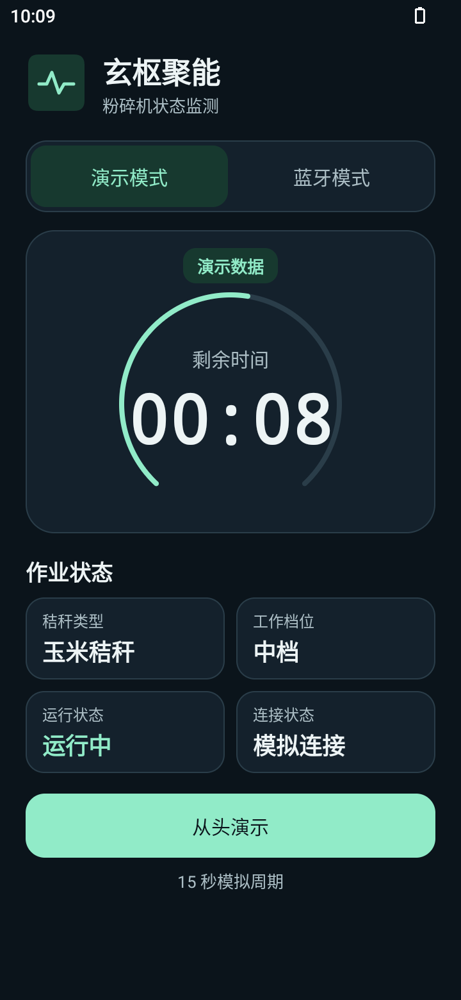
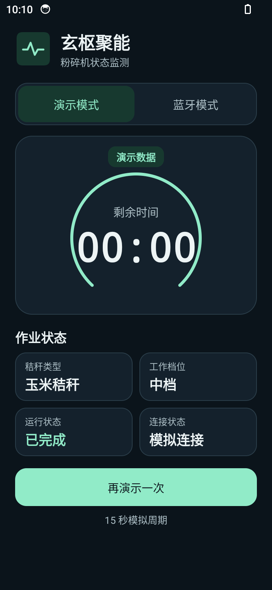
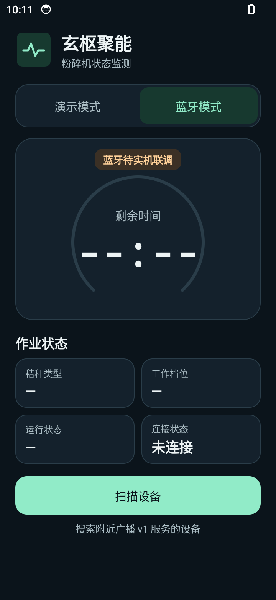

# 玄枢聚能｜粉碎机状态监测

大学生创新训练项目的 Android 原型。STM32H743 负责设备控制和剩余时间计算，ESP32-S3 将状态通过 BLE 提供给手机。App 提供中文监测界面，显示剩余时间、秸秆类型、工作档位、运行状态和连接状态。首版使用原生 Android 和 Java，运行时无需额外库或网络服务。

## 安装和演示

1. 将交付目录或 GitHub Release 附件中的 `xuanshu-shredder-v0.1.0-debug.apk` 保存到 Android 6.0 或更新版本的手机。在文件管理器中打开 APK，按系统提示允许该来源安装应用并完成安装。
2. 打开「玄枢聚能｜粉碎机状态监测」。默认进入「演示模式」，页面标有「演示数据」。无需开发板或蓝牙权限。
3. 点「开始演示」。页面模拟玉米秸秆、中档的一次作业，从 `00:15` 倒计时到 `00:00`，运行状态变为「已完成」。点「再演示一次」可重新播放。

已配置 ADB 的电脑也可以通过 USB 安装。

```powershell
adb install -r .\xuanshu-shredder-v0.1.0-debug.apk
```

APK 采用 Android 调试签名。同一包名使用不同签名时，Android 无法直接覆盖安装。更换签名时需卸载旧副本再安装。

## 蓝牙模式

在首页切换到「蓝牙模式」并点「扫描设备」。Android 12 及更新版本会请求「附近的设备」权限。Android 6 至 11 会请求精确位置权限，扫描时需开启系统位置服务。找到广播 v1 服务的 ESP32-S3 后，在列表中点选设备连接。

- App 优先订阅 GATT 状态特征，订阅不可用且状态特征可读时会轮询。
- 剩余时间直接使用设备的秒数，缺失时显示 `--:--`。
- 连接后 5 秒没有新的有效状态时显示「数据未更新」并清空作业字段。连接中断时显示「已断开」。App 在前台监测，离开页面会释放 BLE 连接。
- [BLE v1 协议](docs/BLE-v1.md)包含服务 UUID、状态字节格式、示例和超时规则。蓝牙待实机联调。

## 编译

工具版本为 **JDK 17**、**Android SDK Platform 35**、**Android SDK Build-Tools 35.0.0**。项目自带 Gradle 8.9 Wrapper，锁定 Android Gradle Plugin 8.7.3。首次构建需要访问 Gradle 分发站点、Google Maven 和 Maven Central。

### Windows

1. 安装 JDK 17。用 Android Studio 的 SDK Manager 或 Android SDK 命令行工具安装 **Android SDK Platform 35**、**Build-Tools 35.0.0**。需要通过 USB 安装时，也安装 **Platform-Tools**。
2. 打开 PowerShell，进入源码根目录，将 `JAVA_HOME` 和 `ANDROID_HOME` 设置为你的实际安装目录。Android Studio 的 SDK Manager 顶部会显示 SDK 路径。
3. 执行以下命令。

```powershell
$env:JAVA_HOME = 'C:\path\to\jdk-17'
$env:ANDROID_HOME = "$env:LOCALAPPDATA\Android\Sdk"
.\gradlew.bat clean :app:assembleDebug :app:testDebugUnitTest :app:lintDebug
```

### Linux / macOS

将 `JAVA_HOME` 和 `ANDROID_HOME` 指向本机的 JDK 17 和 Android SDK，进入源码根目录执行。

```bash
./gradlew clean :app:assembleDebug :app:testDebugUnitTest :app:lintDebug
```

编译生成的 APK 位于 `app/build/outputs/apk/debug/app-debug.apk`。构建可从源码复现。不同机器的调试签名可能不同，APK 的 SHA-256 因此可能不同。

## 验证记录

- 在 Linux 云端用 JDK 17 和 Gradle Wrapper 从干净源码构建。两次从独立目录构建所得 APK 逐字节一致。交付 APK 实测 **32,139 字节（31.39 KiB）**，通过 APK 签名检查。
- 10 项 JVM 单元测试通过，覆盖倒计时、状态帧解析、未知时间、非法帧、序号回绕、重复帧、过期恢复和断线清空。Android Lint 无错误。
- Android 14（API 34）模拟器上验证了 APK 安装、启动、演示倒计时、完成状态、重新演示和切换到蓝牙模式。
- Windows 本机环境、实体 Android 手机及 STM32H743 / ESP32-S3 的端到端连接均待验证。

## 模拟器截图

| 演示倒计时 | 演示完成 | 蓝牙模式 |
| --- | --- | --- |
|  |  |  |

版本变更见 [v0.1.0 发布说明](docs/v0.1.0.md)。

交付 APK 的 SHA-256 为 `8361ed7d6e994ad7f5ff29568c369860af8ee31c212fd0f84f0d9dcd09480e24`。
